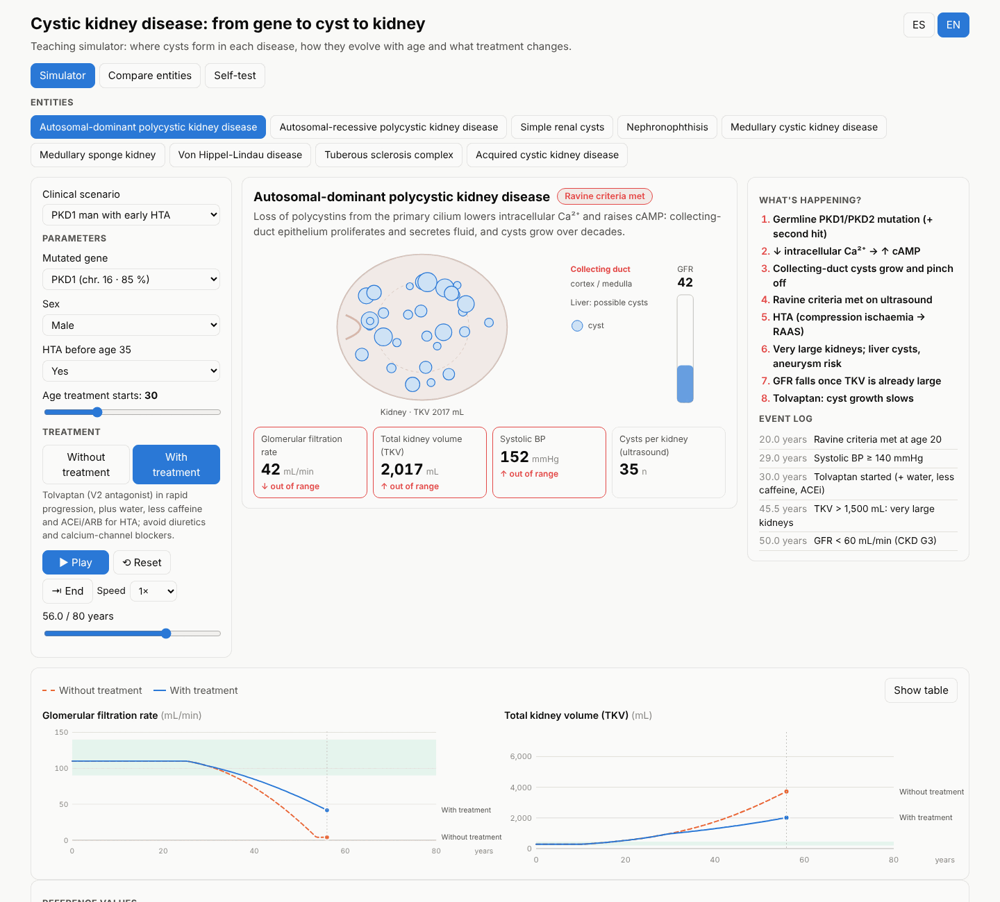

# Cystic kidney disease: from gene to cyst to kidney

**Enfermedades quísticas renales: del gen al quiste y al riñón** — interactive teaching simulator (Spanish / English).

**Live demo:** https://ferasmed-dev.github.io/cystic-kidney-disease/ · English: https://ferasmed-dev.github.io/cystic-kidney-disease/?lang=en



One kidney in coronal section where each disease draws its cysts in its own place — collecting duct, cortico-medullary junction, distal tubule, tumour or diffuse — over the patient's lifetime. Students compare inheritance, age at renal failure and what treatment changes.

## What it shows

| Entity | Where cysts form | Time axis | Treatment arm |
|---|---|---|---|
| ADPKD (PKD1 / PKD2 / PKD3) | collecting duct | age | tolvaptan + water + less caffeine + ACEi from a chosen age |
| ARPKD (PKHD1) | collecting duct | age | portal-hypertension management |
| Simple cysts | distal tubule / collecting duct | age | none needed |
| Nephronophthisis | cortico-medullary junction | age | none (no specific treatment) |
| Medullary cystic disease (UMOD) | cortico-medullary junction | age | none (no specific treatment) |
| Medullary sponge kidney | dilated collecting ducts | age | fluids + thiazides |
| Von Hippel-Lindau | cysts + clear-cell carcinoma | age | surveillance + nephron-sparing surgery at 3 cm |
| Tuberous sclerosis | cysts + angiomyolipoma | age | treat AML ≥ 3.5 cm |
| Acquired cystic disease | proximal and distal, diffuse | years on dialysis | imaging surveillance |

Every entity offers:

- a **schematic** that highlights where the lesion sits and grows with severity;
- **sliders and choices** for the parameters that drive it;
- a **sin / con tratamiento** (without / with treatment) comparison drawn on the same chart (dashed = without, solid = with);
- a **"¿Qué está pasando?"** panel that lights up each step of the mechanism as it happens, plus an **event log**;
- gauges with reference ranges, a **data-table view** of every chart, a **compare** tab with all entities side by side and a **self-test** tab.

## Curriculum fit

For students and teachers at any Spanish medical faculty.

- **Module (Orden ECI/332/2008):** Módulo III, *Formación clínica humana* (with support from Módulo II for physiology and pathology).
- **Typical subjects:** Fisiopatología, Patología médica / Nefrología, Anatomía patológica, Farmacología.
- **MIR:** core content of the Nefrología block.

## For teachers

Every scenario has a deep link you can project or share. Add `&lang=en` for English.

| Preset | Scenario (EN) | Expected result | Link |
|---|---|---|---|
| `pkd1_varon` | PKD1 man with early HTA | Ravine positive at 20, HTA at 29, ESRD at ~52; tolvaptan from 30 delays ESRD to ~64 | [ES](https://ferasmed-dev.github.io/cystic-kidney-disease/?preset=pkd1_varon) · [EN](https://ferasmed-dev.github.io/cystic-kidney-disease/?preset=pkd1_varon&lang=en) |
| `pkd2_mujer` | PKD2 woman | GFR ~52 at 80 untreated (~78 on tolvaptan from 40) | [ES](https://ferasmed-dev.github.io/cystic-kidney-disease/?preset=pkd2_mujer) · [EN](https://ferasmed-dev.github.io/cystic-kidney-disease/?preset=pkd2_mujer&lang=en) |
| `tolvaptan_tardio` | PKD1: late tolvaptan (age 45) | ESRD delayed only to ~55 | [ES](https://ferasmed-dev.github.io/cystic-kidney-disease/?preset=tolvaptan_tardio) · [EN](https://ferasmed-dev.github.io/cystic-kidney-disease/?preset=tolvaptan_tardio&lang=en) |
| `recien_nacido_pqrar` | Newborn with large kidneys | pulmonary hypoplasia, portal HTA at ~6, ESRD at ~9 | [ES](https://ferasmed-dev.github.io/cystic-kidney-disease/?preset=recien_nacido_pqrar) · [EN](https://ferasmed-dev.github.io/cystic-kidney-disease/?preset=recien_nacido_pqrar&lang=en) |
| `quiste_casual` | Incidental cyst on ultrasound | first cyst at 45, prevalence 30 % at 90, no renal failure | [ES](https://ferasmed-dev.github.io/cystic-kidney-disease/?preset=quiste_casual) · [EN](https://ferasmed-dev.github.io/cystic-kidney-disease/?preset=quiste_casual&lang=en) |
| `nefronoptisis_juvenil` | Child with polyuria and renal failure | polyuria at ~6, ESRD at ~14 | [ES](https://ferasmed-dev.github.io/cystic-kidney-disease/?preset=nefronoptisis_juvenil) · [EN](https://ferasmed-dev.github.io/cystic-kidney-disease/?preset=nefronoptisis_juvenil&lang=en) |
| `quistica_medular_adulto` | Adult with familial renal failure and gout | hyperuricaemia at ~23, ESRD at ~62 | [ES](https://ferasmed-dev.github.io/cystic-kidney-disease/?preset=quistica_medular_adulto) · [EN](https://ferasmed-dev.github.io/cystic-kidney-disease/?preset=quistica_medular_adulto&lang=en) |
| `litiasis_recurrente` | Recurrent calcium stones | 15 stone episodes by 70 untreated vs 9 with thiazides from 28; GFR normal | [ES](https://ferasmed-dev.github.io/cystic-kidney-disease/?preset=litiasis_recurrente) · [EN](https://ferasmed-dev.github.io/cystic-kidney-disease/?preset=litiasis_recurrente&lang=en) |
| `vhl_vigilancia` | Von Hippel-Lindau on surveillance | tumour reaches 3 cm at ~30; six surgeries keep risk ~7 % (vs 100 %) | [ES](https://ferasmed-dev.github.io/cystic-kidney-disease/?preset=vhl_vigilancia) · [EN](https://ferasmed-dev.github.io/cystic-kidney-disease/?preset=vhl_vigilancia&lang=en) |
| `et_angiomiolipoma` | Tuberous sclerosis with angiomyolipoma | AML > 4 cm at ~20 untreated; treated at 3.5 cm and shrinks to 1.5 cm | [ES](https://ferasmed-dev.github.io/cystic-kidney-disease/?preset=et_angiomiolipoma) · [EN](https://ferasmed-dev.github.io/cystic-kidney-disease/?preset=et_angiomiolipoma&lang=en) |
| `dialisis_largo_plazo` | Years on dialysis | 34 cysts at 20 years; surveillance cuts the risk index from 24 to 6 | [ES](https://ferasmed-dev.github.io/cystic-kidney-disease/?preset=dialisis_largo_plazo) · [EN](https://ferasmed-dev.github.io/cystic-kidney-disease/?preset=dialisis_largo_plazo&lang=en) |

You can also open a single entity with `?entity=<key>` (keys are listed in `src/model.js`).

## Model

- **ADPKD:** total kidney volume grows from age 10 as `dTKV/dt = r·TKV·(1 − TKV/9000)` with `r` = 5.5 % (PKD1), 2.2 % (PKD2) or 0.8 %/year (PKD3), +0.6 % each for male sex and HTA before 35; tolvaptan halves `r` (TEMPO 3:4). GFR falls from age 25 as `0.5 + 3.4·max(0, ln(TKV/650))` mL/min/year (×0.7 on tolvaptan). Cysts per kidney on ultrasound grow with age and are checked against the **Ravine criteria** from age 20.
- **ARPKD:** GFR falls 2 + 6·severity mL/min/year from birth; portal gradient climbs to 4 + 14·severity mmHg over 12 years (treatment −45 %).
- **Simple cysts:** population prevalence 0 % before 40, ~10 % at 50–70, rising to ~30 % at 90 (×1.15 men, ×0.85 women); GFR only shows age-related decline.
- **Nephronophthisis / medullary cystic disease:** GFR loss starts at age 3 / 18 at 3 + 8·k / 1 + 2.4·k mL/min/year (k = progression/10).
- **Sponge kidney:** stone episodes accrue at 0.12·(calciuria − 180)/100 per year; thiazides cut calciuria by 60 % of the excess over 200 mg/24 h.
- **VHL / TSC:** largest tumour grows linearly; cumulative risk `1 − e^(−∫h)` with hazard 0.05·(size − 3) per year above 3 cm (VHL metastasis) or 0.04·(size − 4) above 4 cm (AML bleeding).
- **Acquired cystic disease:** cysts ≈ 2 + 1.6·years on dialysis; carcinoma risk index grows with the square of time, ×0.25 under surveillance.

GFR is converted to creatinine with a steady-state approximation, `Cr ≈ 90 / GFR` (0.9 mg/dL at 100 mL/min). **Model** tag: constants marked "Model" in `src/model.js` are teaching assumptions tuned so each preset reproduces the textbook course; they are not fitted to patient data.

### Parameters

| Parameter | Range (default) | Basis |
|---|---|---|
| Gene (ADPKD) | PKD1 / PKD2 / PKD3 | PKD1 85 % (ESRD ~54 y), PKD2 15 % |
| Tolvaptan start age | 18–60 (30) | indicated in rapid progression |
| ARPKD severity | 1–10 (6) | Model |
| Baseline urinary calcium | 200–500 mg/24 h (380) | hypercalciuria > 250–300 mg/24 h |
| Tumour growth (VHL / AML) | 0.2–0.8 / 0.1–0.6 cm per year | Model |
| Surgery threshold (VHL) | 3 cm | standard "3-cm rule" |
| Imaging interval (acquired) | 1–5 years (2) | Model |

### Known simplifications

- Both kidneys share one cyst count (symmetrical disease).
- Liver cysts, aneurysms and extrarenal tumours appear as events, not as separate time courses.
- Risk curves are relative teaching indices, not calibrated absolute risks.
- ADPKD progression does not include the Mayo Imaging Classification; TKV is not height-adjusted.

### Content beyond the core notes

- **Tuberous sclerosis skin findings** use the standard criteria (facial angiofibromas, hypomelanotic macules, retinal hamartomas); the notes' summary table lists "café-au-lait spots", which are not a TSC criterion.
- **VHL treatment threshold (3 cm)**, **AML treatment (mTOR inhibitor / embolisation)** and **thiazides for sponge-kidney hypercalciuria** are standard care beyond the core notes.
- The Ravine criteria are implemented as given (the unified Pei 2009 criteria are an alternative for unknown genotype).

## Layout

```
index.html
src/model.js       pure model: entities, gauges, presets, simulate()
src/i18n.js        ES + EN strings (events are factories, so a language switch re-renders them)
src/ui.js          DOM, animation loop, explanations; exposes window.__sim for automated checks
src/schematic.js   SVG schematic of the anatomy, highlighted per entity
src/charts.js      dependency-free SVG line charts with hover tooltips and table view
src/styles.css     light/dark via prefers-color-scheme, responsive
tests/model.test.js
curriculum.json    topic metadata
```

## Run locally

```bash
python3 -m http.server 8000
# open http://localhost:8000/
```

No build step, no dependencies.

## Tests

```bash
npm test        # node --test (Node 18+)
```

The tests cover well-formed output for every entity at default and extreme parameters (finite, non-negative, valid steps), purity, i18n completeness in both languages, every preset, and the key mechanism of each entity (direction of each effect and the treatment comparison). GitHub Actions runs them on every push.

## Deploy (GitHub Pages)

Settings → Pages → *Deploy from a branch* → `main` / `(root)`. The site is served at https://ferasmed-dev.github.io/cystic-kidney-disease/.

## References

- Chapman AB et al. Autosomal-dominant polycystic kidney disease (ADPKD): KDIGO controversies conference. *Kidney Int* 2015.
- Torres VE et al. Tolvaptan in patients with ADPKD (TEMPO 3:4). *N Engl J Med* 2012;367:2407–18.
- Ravine D et al. Evaluation of ultrasonographic diagnostic criteria for ADPKD 1. *Lancet* 1994;343:824–7. Pei Y et al. *J Am Soc Nephrol* 2009.
- Northrup H et al. Updated international tuberous sclerosis complex diagnostic criteria (2021).
- Harrison's Principles of Internal Medicine, 21st ed., Polycystic and tubulointerstitial diseases.
- Farreras-Rozman, *Medicina Interna*, 19ª ed., Nefrología.

---

Herramienta docente · no apta para uso clínico — Teaching tool · not for clinical use. MIT licence © 2026 Feras Elhissi.
